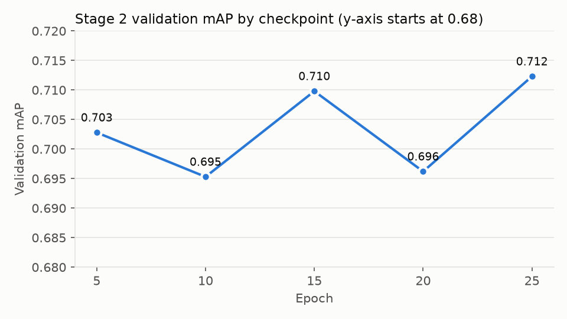
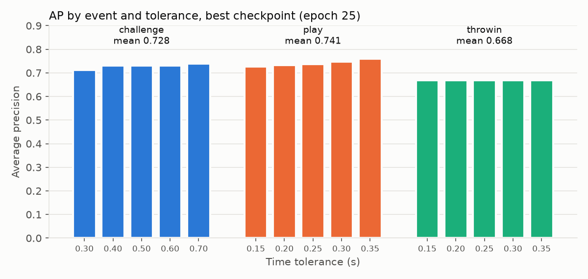

# Event Detection in Football Match Video

This project finds 3 kinds of events in Bundesliga match video: challenges, passes ("play") and throw-ins. For each event, the model gives the time in the video and a confidence score. The task and the data come from the Kaggle competition [DFL - Bundesliga Data Shootout](https://www.kaggle.com/competitions/dfl-bundesliga-data-shootout). The model has 2 stages. A frame classifier scores each video frame. Then a 1D CNN reads the sequence of frame scores and finds the time of each event.

B.Tech Project I (course ITITC22), Netaji Subhas University of Technology (NSUT), Delhi, Jul–Dec 2023. Advisor: Dr. Nisha Kandhoul.

## Method

**Stage 1: frame classifier.** OpenCV extracts the frames of each video (25 fps). Each input stacks 3 grayscale frames (t-1, t, t+1) as the 3 image channels. An ImageNet-pretrained EfficientNet-B0 (`timm`, `tf_efficientnet_b0`) classifies each frame into 10 classes:

- background
- challenge, play, throwin (a short window around the event time)
- pre_challenge, pre_play, pre_throwin (the window just before the event)
- post_challenge, post_play, post_throwin (the window just after the event)

The pre and post classes use more of the labeled frames near each event. Training uses mixed precision, mixup, and albumentations augmentation.

**Stage 2: temporal 1D CNN.** For each frame, a window of 51 frame-score vectors (25 frames on each side) goes into a 1D CNN with 4 Conv1d layers. The CNN gives new scores for the center frame. Post-processing then smooths the scores, takes the peaks in score order, and removes the 16 frames on each side of each peak. The result is a list of (time, event, score) detections.

```
match video, 25 fps
      |  OpenCV: extract frames
      v
frames t-1, t, t+1 (grayscale, stacked as 3 channels)
      |  Stage 1: EfficientNet-B0
      v
10 scores per frame (background, 3 events, 3 pre_, 3 post_)
      |  window of 51 frames around frame t
      v
      |  Stage 2: 1D CNN (4 Conv1d layers)
      v
10 scores per frame
      |  smooth, pick peaks, suppress +/- 16 frames
      v
detections (video, time, event, score)  -->  event-detection AP
```

**Metric.** The score is the competition's event-detection average precision (AP). A detection matches an event if the time error is below a tolerance. Each event class has 5 tolerances (challenge: 0.30 to 0.70 s, play and throw-in: 0.15 to 0.35 s). The final score is the mean AP over the tolerances, then over the 3 events.

## Results

These numbers are the saved outputs of the stage 2 training cell in [`notebooks/BTP_Model.ipynb`](notebooks/BTP_Model.ipynb). Stage 2 trained for 30 epochs and validated after every 5th epoch. [`scripts/plot_results.py`](scripts/plot_results.py) reads them from the notebook into [`results/results.json`](results/results.json) and draws the figures.

| Checkpoint (epoch) | 5 | 10 | 15 | 20 | 25 |
|---|---|---|---|---|---|
| Validation mAP | 0.703 | 0.695 | 0.710 | 0.696 | **0.712** |

AP per event and tolerance at the best checkpoint (epoch 25):

| Event | Tolerances (s) | AP at each tolerance | Mean AP |
|---|---|---|---|
| challenge | 0.30, 0.40, 0.50, 0.60, 0.70 | 0.712, 0.730, 0.730, 0.730, 0.738 | 0.728 |
| play | 0.15, 0.20, 0.25, 0.30, 0.35 | 0.727, 0.734, 0.737, 0.748, 0.760 | 0.741 |
| throw-in | 0.15, 0.20, 0.25, 0.30, 0.35 | 0.668, 0.668, 0.668, 0.668, 0.668 | 0.668 |





**Scope of these numbers.**

- This is not a Kaggle leaderboard score. It is a validation score on a small part of the competition training data.
- Training used a subset of the games: 3 of the 12 match halves that the code lists (`1606b0e6_0`, `ecf251d4_0`, `35bd9041_0`). Stage 1 holds out match half `35bd9041_0` for validation.
- Stage 2 trains the 1D CNN on the frame scores of `35bd9041_0`. The mAP above is on the other match halves in the stage 1 frame-score file. The run did not record which halves that file holds. If they are the stage 1 training halves, the mAP is optimistic.
- The notebook copy lists the 3 halves in both the stage 1 training list and the stage 1 validation list. The exported script and [`src/dfl/config.py`](src/dfl/config.py) use the split above.
- Frame accuracy is not reported, because most frames are background frames and a model that predicts "background" for every frame already gets a high accuracy.

## How to run

You need a CUDA GPU for both training stages.

1. Install the dependencies.

   ```
   pip install -r requirements.txt
   ```

2. Get the data from Kaggle: [DFL - Bundesliga Data Shootout](https://www.kaggle.com/competitions/dfl-bundesliga-data-shootout). Accept the competition rules. Download the data with the Kaggle website or the Kaggle CLI. Do not put your `kaggle.json` file in this repository.

3. Unzip the data so that `train.csv` and the `train/` video folder are in one directory. Then set the paths.

   ```
   export DFL_DATA_DIR=./data    # has train.csv and train/*.mp4
   export DFL_WORK_DIR=./work    # frames, checkpoints and frame scores go here
   ```

   You can also set `DFL_TRAIN_CSV`, `DFL_VIDEO_DIR` and `DFL_FRAME_PREDS`. See [`src/dfl/config.py`](src/dfl/config.py).

4. Run stage 1. Extract the frames, train the frame classifier, then save its frame scores for stage 2.

   ```
   python scripts/train_frames.py extract
   python scripts/train_frames.py train
   python scripts/train_frames.py export --checkpoint work/models/<checkpoint>.pth
   ```

5. Run stage 2.

   ```
   python scripts/train_temporal.py
   ```

6. Run the metric tests (they need only pandas, numpy and pytest).

   ```
   python -m pytest tests
   ```

## Changes from the original notebook

The model and the training logic are the same as in the notebook. The refactor made these changes:

- The code is now in modules and scripts. Paths come from environment variables. All hyperparameters are in `config.py`.
- The Colab-only lines (Google Drive mount, `!pip`, Kaggle credential lines) and dead code are removed. The cell that showed a sample batch is removed.
- The notebook loads the stage 1 frame-score file but does not contain the code that wrote it. `train_frames.py export` writes a file with the same keys.
- Small fixes to code that did not run as written: the checkpoint name used an undefined `fold` (now `FOLD = 0`), the video list matched the folder and not the video files, and the frame-file name returned by the dataset no longer depends on the work directory name.
- The metric returns 0 for an empty submission. The original code raised an error for that input. Other inputs give the same result.

## Repository layout

```
README.md
LICENSE
requirements.txt
src/dfl/
    config.py        paths (from environment variables) and hyperparameters
    data.py          labels with pre/post classes, frame extraction, datasets, transforms
    models.py        net (EfficientNet-B0 frame classifier), cnn (1D CNN)
    postprocess.py   frame scores to scored detections
    metric.py        event-detection AP, adapted from the competition metric
scripts/
    train_frames.py  stage 1: extract, train, export
    train_temporal.py  stage 2
    plot_results.py  notebook outputs to results/results.json and figures
results/
    results.json
    val_map_by_checkpoint.png
    ap_by_event_tolerance.png
notebooks/
    BTP_Model.ipynb  original notebook with saved outputs
tests/
    test_metric.py
```

## Acknowledgements

Team: Ramansh Goyal, Siddharth Dhaka. Advisor: Dr. Nisha Kandhoul.

The evaluation metric in `src/dfl/metric.py` is adapted from the public evaluation metric of the Kaggle competition DFL - Bundesliga Data Shootout. The data comes from the same competition.

## Author

Code and experiments: Nishchay Mago.
